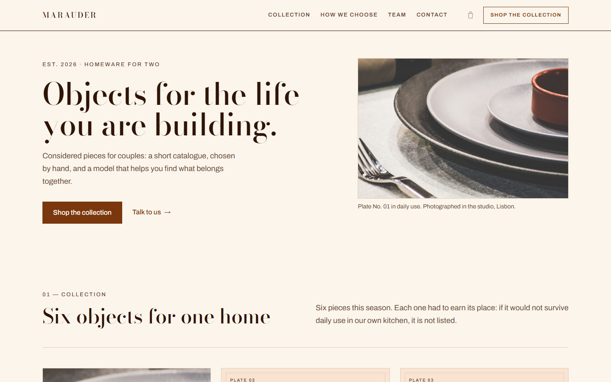
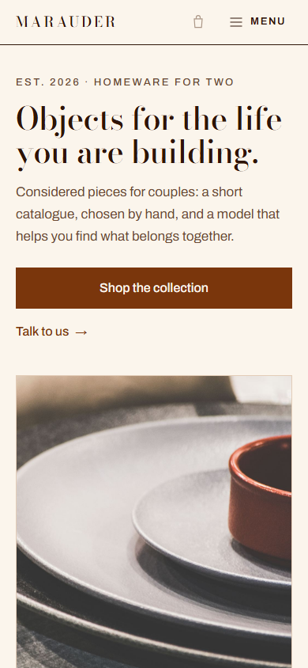
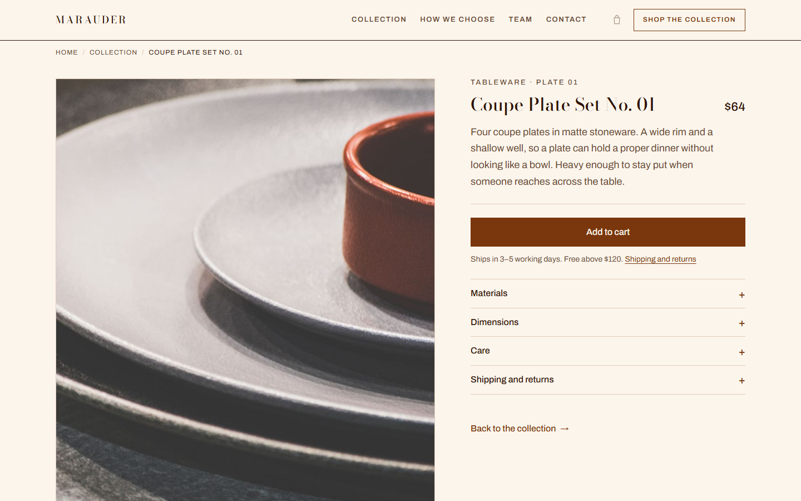
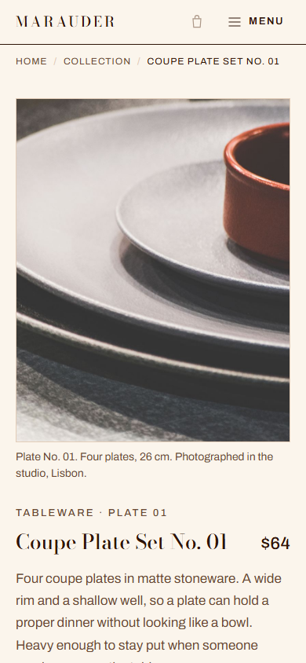
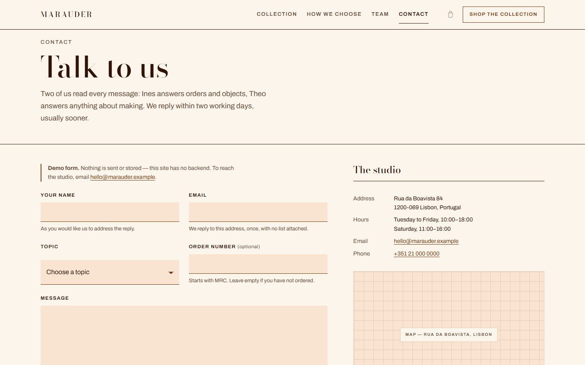
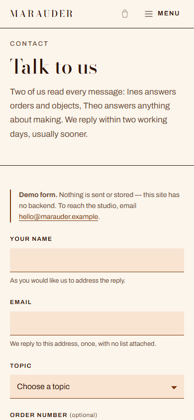
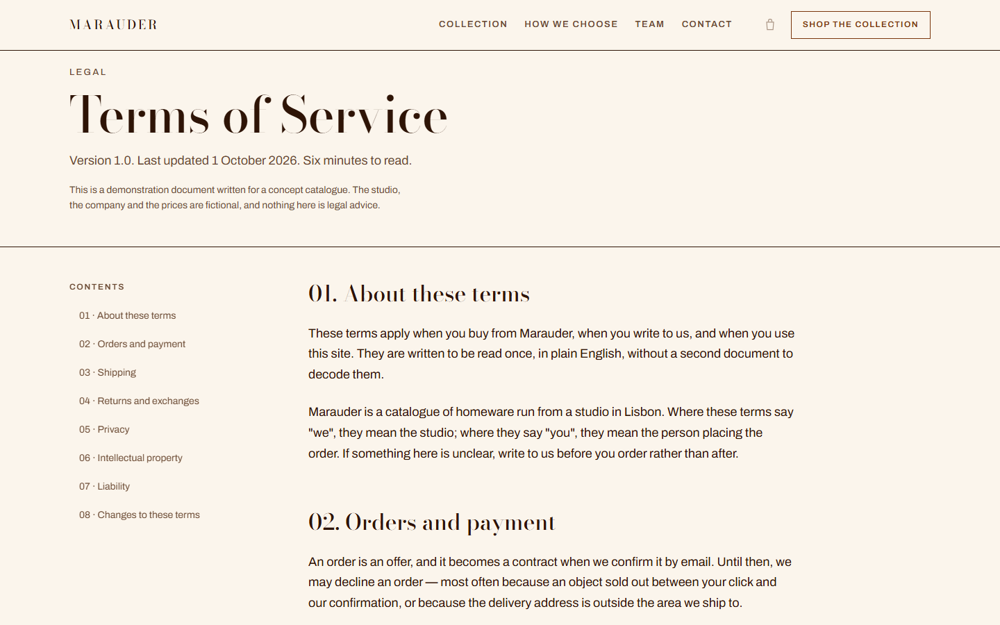
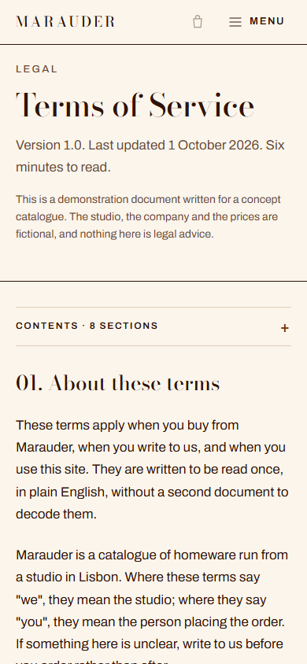
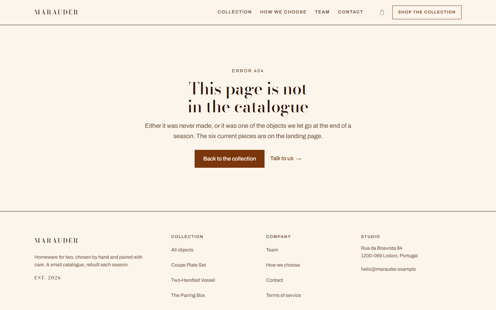
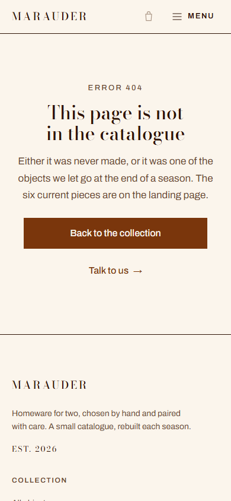

# Marauder

A concept storefront for a fictional homeware studio: a short catalogue of six objects for two people, photographed and written like a small independent shop rather than a marketplace.

Built as a static HTML/CSS/JS site for a portfolio. There is no framework, no build step, and no backend — open a page and it runs.

**Status:** complete, manually tested, and deployed to GitHub Pages. Cart, checkout and the contact form are demonstration-only.

**Live demo:** https://compavel.github.io/marauder/

---

## The problem

Most homeware shops online overwhelm you with hundreds of near-identical products, stock badges and discount banners. This concept asks the opposite: a shop that lists six things, explains why each one exists, and helps two people starting a home choose a first object without a decision tree.

The site is also a front-end exercise: editorial layout, a restrained palette, real responsive behaviour, and accessible interactions without a component library.

## Features

- **Landing page** with a split editorial hero, the six-piece collection, an editorial photo band, the studio's values, team section, and a closing call to action.
- **Six product detail pages** with:
  - breadcrumb and product metadata
  - price, variant selector (where relevant), sold-out state
  - native `<details>` accordion for materials, dimensions, care and shipping
  - a sticky mobile buy bar that appears only after the inline CTA scrolls out of view
  - JSON-LD `Product` structured data
- **Working variant pricing** — choosing a variant updates both the displayed price and the sticky bar price.
- **Demo cart handling** — `Add to cart` is wired to an accessible inline note explaining that checkout is not connected, instead of a dead button.
- **Contact page** with client-side validation (field-level errors, an error summary, focus management), a honeypot field, a message counter, and an explicitly labelled demo panel. No data leaves the browser, and the panel never claims the message was sent.
- **Terms page** with a sticky table of contents on desktop, an accordion on mobile, and scroll-spy highlighting the current section.
- **Custom 404 page** with a way back to the collection.
- **Responsive mobile navigation** with focus trap, `Esc` to close, scroll lock and focus return to the toggle.
- **Accessibility details** — skip link, one `h1` per page, labelled form fields, `aria-invalid`/`aria-describedby`, visible focus rings, reduced-motion support, and contrast-checked palette.
- **Performance basics** — self-hosted subset fonts, no JavaScript dependencies, `width`/`height` on images to prevent layout shift, lazy loading below the fold.

## Pages

| File | Purpose |
| --- | --- |
| `index.html` | Landing page: hero, collection, values, team, CTA |
| `product/coupe-plate-set.html` | Product detail (reference page, has photography) |
| `product/two-handled-vessel.html` | Product detail |
| `product/the-pairing-box.html` | Product detail |
| `product/linen-napkin-set.html` | Product detail with variants |
| `product/stoneware-tumbler-pair.html` | Product detail |
| `product/beeswax-candle-no-03.html` | Product detail, sold-out state |
| `contact.html` | Contact form + studio information |
| `terms.html` | Terms of service |
| `404.html` | Not-found page |

## Screenshots

| Landing — desktop | Landing — mobile |
| --- | --- |
|  |  |

| Product — desktop | Product — mobile |
| --- | --- |
|  |  |

| Contact — desktop | Contact — mobile |
| --- | --- |
|  |  |

| Terms — desktop | Terms — mobile |
| --- | --- |
|  |  |

| 404 — desktop | 404 — mobile |
| --- | --- |
|  |  |

## Tech stack

- HTML5, hand-written CSS (custom properties, grid, container-free responsive layout)
- Vanilla JavaScript (no dependencies)
- Self-hosted WOFF2: **Bodoni Moda** for display, **Archivo** for text
- No build step, no package manager, no framework

## Project structure

```
marauder/
├── index.html
├── contact.html
├── terms.html
├── 404.html
├── product/
│   └── six product pages
├── assets/
│   ├── css/
│   │   ├── tokens.css      design tokens, type scale, breakpoints
│   │   ├── base.css        reset, typography, layout primitives
│   │   ├── components.css  buttons, cards, forms, header, menu, buy bar
│   │   └── pages.css       page-specific layout
│   ├── js/
│   │   └── main.js         navigation, accordion, form, sticky bar, TOC
│   ├── fonts/              two WOFF2 subsets
│   └── img/                hero, editorial, product and OG images
├── docs/screenshots/
├── PRD.md                  product requirements
├── DESIGN-BRIEF.md         visual system and component spec
└── CREDITS.md              photography and font credits
```

## Run locally

There is nothing to install. Any static file server works:

```bash
# PHP (already available in this environment)
php -S 127.0.0.1:8130 -t .

# or Python
python -m http.server 8130
```

Then open `http://127.0.0.1:8130/`.

Opening `index.html` directly with `file://` mostly works, but a local server is recommended so that relative paths and fonts behave exactly as in production.

## Design decisions

- **Palette:** paper `#FBF5EC`, ink `#2E1406`, brand `#7A360C`, accent `#D4631F`. Ink on paper measures 15.9:1; brand on paper 8.2:1. The accent is only used for large text and decorative marks because it does not reach 4.5:1 at body size.
- **Radius 0 everywhere** and 1px rules instead of shadows, so the interface reads as printed matter.
- **Type scale** built on a 4px spacing rhythm, with display sizes dropping at 900px and 767px rather than fluid-clamping everything.
- **One photography source, several crops:** the hero, editorial band, OG image and the product still are all cropped from the same CC0 photograph to keep the art direction coherent while product photography is unavailable.
- **No fake commerce:** the cart is disabled, "Add to cart" explains the demo state, and the sold-out product is marked as such in the UI and in JSON-LD.

## Known limitations

Honest list of what is **not** finished:

- **Deployment:** live on GitHub Pages at <https://compavel.github.io/marauder/>, published by the `Deploy site` workflow only after the checks pass. GitHub Pages ignores `_headers`, so only the meta CSP and referrer policy apply there — no `X-Frame-Options`, `nosniff` or `Permissions-Policy`. Deploy to Netlify or Cloudflare Pages to get the full header set.
- **Product photography:** only the Coupe Plate Set has a photograph. The other five products use a typographic "plate" placeholder (`PLATE 03` … `PHOTOGRAPH PENDING`) rather than stock photos that would misrepresent the objects.
- **Team portraits:** placeholder monogram plates with the same "photograph pending" note.
- **Cart and checkout:** not implemented. Buttons surface a demo note.
- **Contact form:** validates in the browser and shows a clearly labelled demo panel; it does not send or store anything. Server-side validation and rate limiting are required before it becomes a real contact channel (see [`SECURITY.md`](SECURITY.md)).
- **Terms of service:** demonstration copy for a fictional studio, not legal advice.
- **Six products instead of three:** the design brief targeted three example products; the catalogue was extended to six so the collection grid has no dead cards. This deviation is intentional and documented.
- **No unit tests:** this is a static site with no application logic to unit test. Automated static checks cover links, anchors, markup, CSP and JS sinks; visual and interaction behaviour was verified manually and with scripted browser checks (layout overflow at nine viewports, keyboard flows).

## Security

This is a static site: no accounts, sessions, database, API or payment flow. CSP and security headers are configured in `_headers` for hosts that support them, with a meta CSP fallback on every page. Deployment runs through `.github/workflows/pages.yml`: `scripts/check.mjs` must pass, then `scripts/build-site.mjs` assembles a whitelisted `_dist` (pages and `assets/` only), so internal documents never reach the published site. `_redirects` still returns `404` for those paths on Netlify; Cloudflare Pages ignores `404` rules, so leave the files out of the publish directory there. See [`SECURITY.md`](SECURITY.md) for the current posture and the requirements before adding a backend or checkout.

## Verification performed

- Layout checked without horizontal overflow at 1440, 1280, 1024, 900, 768, 480, 390, 360 and 320px.
- Every local `href`/`src` resolves; every same-page anchor exists.
- One `h1` per page, every `` has `alt`, every page has a title and meta description.
- JSON-LD on product pages parses as valid JSON.
- Keyboard: skip link, mobile menu open/close with `Esc` and focus return, form errors focus the first invalid field, success panel moves focus to its heading.
- Browser console clean on the pages tested.
- Live deployment checked: all pages and assets return `200`, internal documents return `404`, unknown paths serve the custom `404.html`, and the live HTML is byte-identical to the repository copy.

## Automated checks

```sh
node scripts/check.mjs       # HTML, links, anchors, CSP, alt text, JSON-LD, JS sinks
node --check assets/js/main.js
node scripts/build-site.mjs  # assembles _dist exactly as the deploy does
```

The same commands run in `.github/workflows/pages.yml`. A failing check stops the build, so nothing reaches GitHub Pages until it passes.

## Future improvements

- Real product and team photography.
- A small backend (or form service) for the contact form, with server-side validation and spam protection.
- A real cart and checkout, or an explicit "enquire to order" flow that matches the studio concept.
- More products and a proper collection filter once the catalogue grows.
- Open Graph image variants per product.

## Author

Tegar Raditya Permana Putra — [github.com/compavel](https://github.com/compavel)

Concept, copy and code are original. The studio, people, products, prices and address are fictional.

Photography and font credits: see [CREDITS.md](CREDITS.md).
